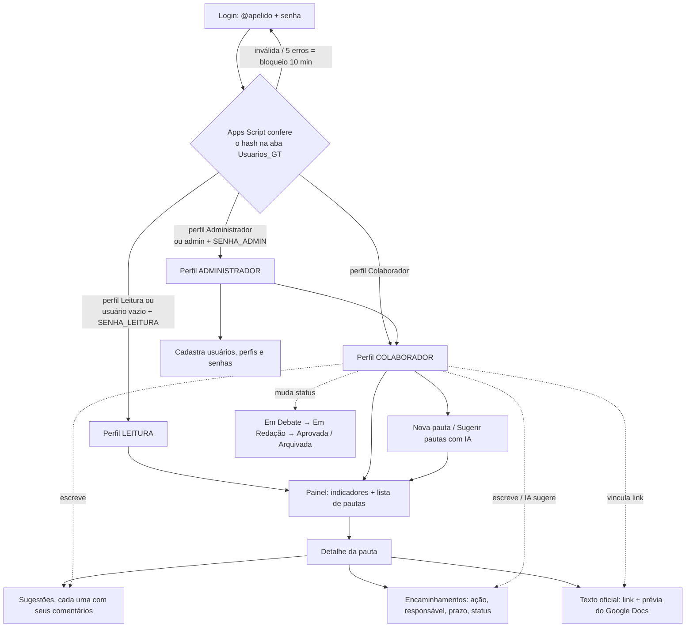
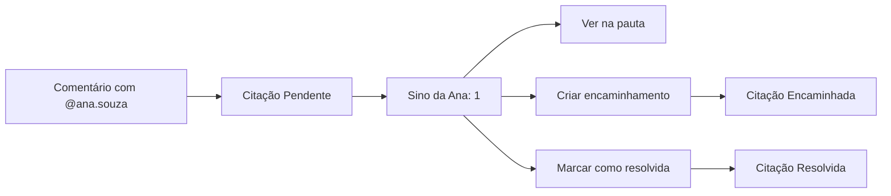

# Sistema de Apoio a Reuniões

Desenvolvido por **GTIC Hemobrás**.

Frontend em HTML, CSS e JS puros. O backend é um Google Apps Script ligado a uma Planilha Google. A IA usa o Google Gemini, pela API do AI Studio no plano gratuito.

| Arquivo      | Função |
|--------------|--------|
| `index.html` | Estrutura das telas (login, painel e modais) |
| `style.css`  | Visual (paleta bordô) |
| `app.js`     | Lógica do frontend, chamadas à API e modo demonstração |
| `Code.gs`    | Backend no Apps Script (colar no editor da planilha) |

---

## 1. Fluxo

**Grupos de trabalho (GTs):** cada pauta pertence a um GT.
- Ao entrar, aparece a **lista de GTs**, com o número de pautas ativas, as em debate e as ações em aberto e atrasadas de cada um. Ao clicar num GT, abre o painel com as pautas dele, e **"← Todos os GTs"** volta à lista.
- Só o **administrador** cria, renomeia, descreve e desativa GTs. Um GT desativado some para os demais usuários, mas as pautas dele ficam guardadas.
- As pautas criadas antes dos GTs, sem `ID_Grupo`, pertencem ao **GT-Sistemas**.
- Nova pauta e "Sugerir pautas com IA" valem para o GT aberto. O sino de citações reúne todos os GTs, e ao abrir uma citação o sistema vai para o GT dela.

**Sugestões e comentários:** na aba **Sugestões**, o colaborador registra sugestões para a pauta. Cada sugestão tem os **próprios comentários** logo abaixo, com uma caixa "Comentar" em cada uma. Na planilha, o comentário guarda na coluna `ID_Pai` o ID da sugestão a que pertence. Comentários antigos, de antes dessa mudança, aparecem em "Comentários gerais anteriores".
Só o usuário **@marco.nunes** vê a lixeira em cada sugestão e em cada comentário (a lista fica em `EXCLUEM_INTERACOES`, no Code.gs). **Toda exclusão pede a senha de quem está logado**, inclusive a de metadados. Senhas erradas contam para o mesmo bloqueio de 10 minutos do login. Ao excluir uma sugestão, os comentários dela e as citações e curtidas ligadas a eles também são apagados da planilha. O sistema pede confirmação antes, e a exclusão não pode ser desfeita.

**Como mudar o status** (só para Colaborador e Administrador):
- **Pauta:** abra a pauta e use a caixa de seleção no canto superior direito do detalhe, ao lado de "Editar". A mudança é salva na hora.
- **Encaminhamento:** na aba **Encaminhamentos**, use a caixa de seleção da coluna **Status**.
- **Citação:** no sino, use **Criar encaminhamento** ou **Marcar como resolvida**.

**Ciclo da pauta:** `Em Debate` → `Em Redação` (o texto oficial está sendo escrito no Google Docs) → `Aprovada` ou `Arquivada`.

**Ciclo do encaminhamento:** `Pendente` → `Em Andamento` → `Concluído` ou `Cancelado`. Um encaminhamento em aberto com prazo vencido aparece como **atrasado** em vermelho.

**Curtidas e comentários nas sugestões:** qualquer usuário com login próprio, **inclusive o perfil Leitura**, pode curtir e comentar as sugestões. Cada usuário curte uma sugestão uma vez só (clicar de novo desfaz), e passar o mouse sobre o botão mostra quem curtiu. Comentários não têm limite. Criar sugestões continua restrito a Colaborador e Administrador. O observador sem cadastro só vê o número de curtidas. As curtidas ficam na aba `Curtidas_GT`, criada sozinha na primeira curtida.

**Metadados para a IA:** o **administrador** cadastra, no botão **Metadados IA** do topo (todos os GTs) ou no mesmo botão dentro de um GT (já vinculado a ele), orientações que a IA deve seguir ao analisar a discussão de uma pauta (✦ Sugerir com IA, na aba Encaminhamentos). Cada metadado vale para **todos os GTs** ou para um GT só. Os ativos seguem junto com a pauta e os comentários, e a síntese mostra quantos foram seguidos. Eles ficam na aba `Recomendacoes_IA` da planilha, criada sozinha no primeiro cadastro.

**Usuários e login:**
- No primeiro acesso, entre com o usuário **`admin`** e a senha `SENHA_ADMIN`. Vá em **Usuários** e cadastre as pessoas com nome, @apelido (gerado do nome, ex.: `marco.nunes`), e-mail opcional, **perfil** e **senha inicial** (mínimo de 6 caracteres).
- Cada pessoa entra com o próprio @apelido e senha, e pode trocar a senha no botão **Senha**, no topo.
- O administrador muda o perfil, **redefine a senha** de quem esqueceu e desativa usuários. Um usuário desativado perde o acesso na hora, e o histórico dele é mantido.
- O autor de pautas e comentários é sempre quem está logado. O servidor define o autor, e o navegador não consegue alterá-lo.
- **Observador:** se a propriedade `SENHA_LEITURA` estiver definida, quem deixar o usuário em branco e usar essa senha entra só para acompanhar. Coloque `desativado` nela para desligar esse acesso.

**Citações (@):**
- Ao digitar `@` num comentário, aparece uma lista de usuários para completar (setas e Enter, ou clique). Cada `@apelido` de usuário ativo gera uma **citação**.
- A pessoa citada vê o **sino** com o número de citações pendentes. Em cada citação ela pode:
  - **Ver na pauta**: abre o comentário.
  - **Criar encaminhamento**: abre o formulário já preenchido com o nome dela, e a citação passa a `Encaminhada`.
  - **Marcar como resolvida**.
- Se a propriedade `NOTIFICAR_EMAIL = sim` estiver definida, o citado também recebe um e-mail.

**IA (somente colaborador):** a IA só sugere. Nada é gravado na planilha até alguém clicar em **Adotar**.
- *Sugerir pautas*: analisa as pautas e os encaminhamentos existentes e propõe novas pautas. Aceita um foco opcional.
- *Sugerir encaminhamentos*: resume a discussão da pauta e propõe ações com prazo. O responsável é confirmado antes de adotar.

---

## 2. Planilha e Apps Script

1. Abra a planilha do GT e vá em **Extensões → Apps Script**.
2. Substitua todo o conteúdo pelo arquivo `Code.gs` e salve.
3. No menu de funções, selecione **`configurar`** e clique em **Executar**. Autorize quando o Google pedir.
   - Rode de novo sempre que colar uma versão nova do código. Assim o Google pede as autorizações novas, como e-mail e IA. Sem isso, a API falha.
   - Cria ou ajusta as abas `Ideias_GT` (com a coluna `ID_Grupo`), `Interacoes_GT`, `Encaminhamentos_GT`, `Usuarios_GT`, `Citacoes_GT` e `Grupos_GT`, e registra o GT-Sistemas, com cabeçalho e colunas que faltarem. Planilhas antigas continuam funcionando.
   - Se não houver `SENHA_ADMIN`, gera uma senha aleatória e mostra no **Registro de execução** (anote). Se existir uma `SENHA_ESCRITA` antiga, ela vira a `SENHA_ADMIN`.
   - Nenhuma senha fica no código: todas vêm das Propriedades do script.
4. Vá em **Configurações do projeto (⚙) → Propriedades do script** e defina:

   | Propriedade      | Valor |
   |------------------|-------|
   | `SENHA_ADMIN`    | senha do usuário `admin` (primeiro acesso e gestão de usuários) |
   | `SENHA_LEITURA`  | *(opcional)* senha do observador sem cadastro; sem ela, esse acesso fica desligado |
   | `GEMINI_API_KEY` | chave gerada em https://aistudio.google.com/apikey |
   | `GEMINI_MODELO`  | *(opcional)* padrão `gemini-2.5-flash` |
   | `NOTIFICAR_EMAIL`| *(opcional)* `sim` para mandar e-mail a quem for citado |
   | `URL_SISTEMA`    | *(opcional)* endereço do sistema, incluído no e-mail |

   > Use senhas fortes e não as coloque no código nem neste repositório.
   > As senhas dos usuários não ficam nas propriedades: elas ficam na aba `Usuarios_GT`, como hash (coluna `Senha_Hash`). Não edite essa coluna à mão; use **Redefinir senha** no sistema.
5. Vá em **Implantar → Gerenciar implantações → Editar (lápis) → Versão: Nova versão → Implantar**.
   - Executar como: **Eu** · Quem pode acessar: **Qualquer pessoa**.
   - Ao editar a implantação existente, a URL continua a mesma. Se criar uma implantação nova, cole a URL em `API_URL` no início do `app.js`.

## 2.1 Ativar a IA (Gemini)

1. Acesse https://aistudio.google.com/apikey com uma conta Google e clique em **Create API key** (Criar chave de API). Copie a chave, que começa com `AIza`.
2. No Apps Script, vá em **Configurações do projeto (⚙) → Propriedades do script → Adicionar propriedade**:
   - Propriedade: `GEMINI_API_KEY`
   - Valor: a chave copiada
   - Clique em **Salvar propriedades do script**.
3. Volte ao **Editor**, selecione a função **`testarIA`** (ou `testarGemini`, só para o Google) e clique em **Executar**. Na primeira vez, autorize o acesso a "serviços externos".
4. Leia o **Registro de execução**:
   - `✅ IA funcionando`: pronto, os botões de IA já funcionam no sistema, sem precisar reimplantar.
   - `modelo não está disponível`: o registro lista os modelos "flash" liberados para a sua chave. Crie a propriedade `GEMINI_MODELO` com um deles.
   - `chave inválida`: gere outra chave no AI Studio e substitua o valor.

### Groq como reserva (opcional, recomendado)

Com o Groq configurado, se o Gemini estiver sobrecarregado (erro 503), no limite ou com erro, **o Groq responde automaticamente**, sem o usuário perceber.

1. Acesse https://console.groq.com, crie uma conta gratuita e vá em **API Keys → Create API Key**. Copie a chave, que começa com `gsk_`.
2. Nas **Propriedades do script**, adicione `GROQ_API_KEY` com a chave.
3. No editor, execute **`testarIA`**. Ela testa as duas IAs e mostra a ordem de uso.

| Propriedade | Para quê |
|---|---|
| `GROQ_API_KEY` | chave do Groq |
| `GROQ_MODELO` | *(opcional)* padrão `llama-3.3-70b-versatile`. Se o modelo for desativado, outro é escolhido e gravado sozinho |
| `IA_PRINCIPAL` | *(opcional)* `groq` para usar o Groq primeiro e o Gemini como reserva |

Basta ter uma das chaves; com as duas, uma cobre a outra.

> A chave fica só no Apps Script e nunca chega ao navegador. Não a coloque no `app.js` nem a compartilhe. No plano gratuito, os dados enviados podem ser usados pelo Google para melhorar os modelos. Evite colocar informações sigilosas nas pautas que forem enviadas à IA.

## 3. Publicar o frontend

Os três arquivos (`index.html`, `style.css`, `app.js`) são estáticos. Coloque-os em qualquer servidor web, como a intranet, o GitHub Pages ou um servidor interno. Abrir pelo `file://` também funciona na maioria dos navegadores.

## 4. Testar sem a planilha

Abra `index.html?demo`. Os dados ficam em memória e a IA é simulada.
Acessos do demo:

| Usuário | Senha | Perfil |
|---------|-------|--------|
| `admin` | `demo-admin` | Administrador |
| `marco.nunes` ou `ana.souza` | `123456` | Colaborador |
| `bruno.lima` | `123456` | Leitura |
| *(em branco)* | `demo-ver` | Observador |

Essas senhas valem só no modo demo, que roda inteiro no navegador. Elas não dão acesso ao sistema real.

---

## Observações técnicas

- Todas as chamadas são `POST` com `Content-Type: text/plain`, para a senha não ir na URL e não haver *preflight* CORS.
- A senha só trafega no login. Depois, o navegador usa um token de sessão, que expira após 6 horas sem uso e é apagado ao clicar em **Sair** ou fechar a aba.
- As senhas são guardadas como SHA-256 com salt e 300 iterações. O hash nunca é enviado ao navegador. Depois de 5 tentativas erradas, o login daquele usuário fica bloqueado por 10 minutos.
- As gravações usam `LockService`, então duas pessoas salvando ao mesmo tempo não se sobrescrevem.
- **Carga parcial**, para a planilha poder crescer:
  - Ao entrar, vem só um **resumo**: as pautas com contadores, a descrição cortada em 300 caracteres, os usuários e as citações de quem entrou.
  - As sugestões, os comentários e os encaminhamentos de uma pauta só são buscados quando ela é aberta (`DETALHE_IDEIA`).
  - Uma pauta já aberta reaparece na hora e se atualiza em segundo plano, com o indicador "Atualizando…" no topo.
- O login e as gravações já devolvem os dados atualizados, sem uma segunda requisição. Ao recarregar a página, a última tela carregada aparece na hora a partir de uma cópia na aba do navegador, que é apagada ao sair ou fechar a aba.
- Numa planilha simulada com 300 pautas, 15 mil sugestões e comentários e 4 mil encaminhamentos, a carga inicial caiu de cerca de 6 MB para 190 KB, e o processamento ficou cerca de 5 vezes mais rápido. Abrir uma pauta trafega cerca de 20 KB.
- Os textos digitados são escapados antes de aparecer na tela, o que evita injeção de HTML.
- O link do texto oficial só é aceito se for `docs.google.com` ou `drive.google.com`. Para a prévia aparecer dentro do sistema, o documento precisa estar compartilhado com quem vai ver.
- A chave do Gemini fica só no Apps Script e nunca chega ao navegador.
- E-mail e perfil dos usuários só chegam ao navegador de administradores.
- Só a própria pessoa citada (ou um administrador) pode marcar a citação como resolvida.
