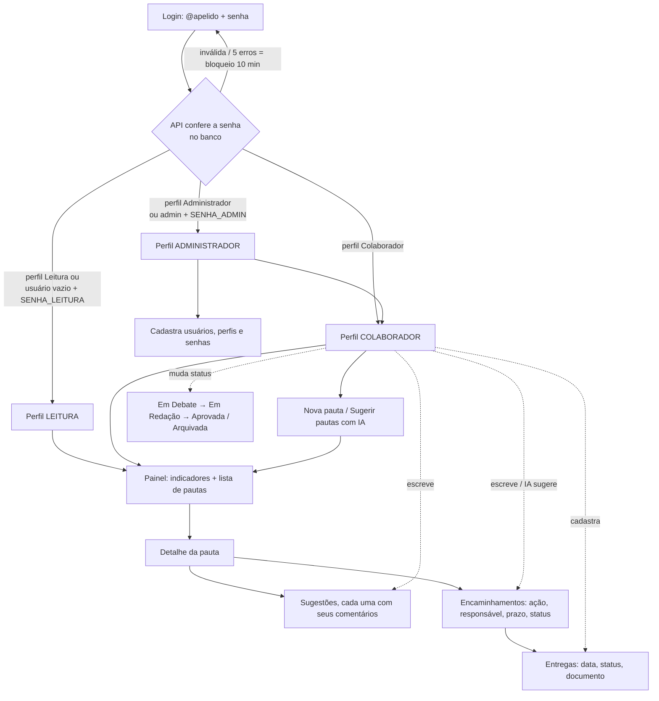
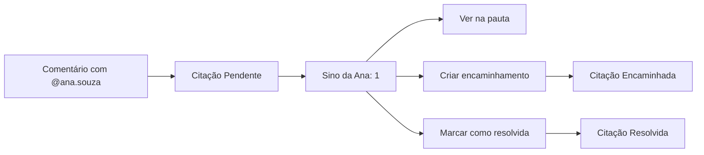

# Sistema de Apoio a Reuniões

Desenvolvido por **GTIC Hemobrás**.

Frontend em HTML, CSS e JS puros, servido pelo Nginx. Backend em Node.js + Express + TypeScript, com MySQL via Sequelize. A IA usa o Google Gemini, com o Groq como reserva. Tudo roda em contêineres Docker.

| Pasta / arquivo | Função |
|---|---|
| `frontend/` | Telas (`index.html`, `style.css`, `app.js`, `logo.svg`), o fluxo da aplicação em `docs/` e o Nginx que serve os arquivos e repassa `/api` ao backend |
| `backend/` | API REST: models, controllers, rotas, middlewares de autenticação e perfil, migrations e a importação da planilha |
| `docker-compose.yml` | Mesmo layout do servidor (letramento na raiz, este sistema em `/sistemadereunioes/`), construído a partir das pastas do clone |
| `servidor/` | O mesmo layout, construindo este sistema direto do GitHub (sem clonar o repositório inteiro) |
| `.env.example` | Modelo das senhas e chaves (copie para `.env`, que nunca vai para o Git) |

---

## 1. Fluxo



**Grupos de trabalho (GTs):** cada pauta pertence a um GT.
- Ao entrar, aparece a **lista de GTs**, com o número de pautas ativas, as em debate e as ações em aberto e atrasadas de cada um. Ao clicar num GT, abre o painel com as pautas dele, e **"← Todos os GTs"** volta à lista.
- Só o **administrador** cria, renomeia, descreve e desativa GTs. Um GT desativado some para os demais usuários, mas as pautas dele ficam guardadas.
- As pautas criadas antes dos GTs, sem `ID_Grupo`, pertencem ao **GT-Sistemas**.
- Nova pauta e "Sugerir pautas com IA" valem para o GT aberto. O sino de citações reúne todos os GTs, e ao abrir uma citação o sistema vai para o GT dela.

**Sugestões e comentários:** na aba **Sugestões**, o colaborador registra sugestões para a pauta. Cada sugestão tem os **próprios comentários** logo abaixo, com uma caixa "Comentar" em cada uma. No banco, o comentário guarda em `ID_Pai` o ID da sugestão a que pertence. Comentários antigos, de antes dessa mudança, aparecem em "Comentários gerais anteriores".
**Só o administrador exclui**; colaboradores apenas incluem e editam. O administrador vê a lixeira em cada sugestão, comentário, encaminhamento e entrega, e o botão "Excluir documento" nas entregas. **Toda exclusão pede a senha de quem está logado**, inclusive a de metadados. Senhas erradas contam para o mesmo bloqueio de 10 minutos do login. Ao excluir uma sugestão, os comentários dela e as citações e curtidas ligadas a eles também são apagados. Ao excluir um encaminhamento, as entregas que só pertencem a ele também são apagadas, com os documentos; uma entrega ligada a outro encaminhamento fica. O sistema pede confirmação antes, e a exclusão não pode ser desfeita.

**Como mudar o status** (só para Colaborador e Administrador):
- **Pauta:** abra a pauta e use a caixa de seleção no canto superior direito do detalhe, ao lado de "Editar". A mudança é salva na hora.
- **Encaminhamento:** na aba **Encaminhamentos**, use a caixa de seleção da coluna **Status**.
- **Citação:** no sino, use **Criar encaminhamento** ou **Marcar como resolvida**.

**Encaminhamentos e entregas:** a pauta é discutida, o gestor cria o encaminhamento e depois as entregas são registradas nele. Não existe uma aba de entregas: na aba **Encaminhamentos**, a coluna **Entregas** tem um botão com a contagem ("0 entregas", "1 entrega"...). Ao clicar, a área da lista de encaminhamentos passa a mostrar as entregas daquele encaminhamento: em cima, **← Voltar aos encaminhamentos** e **+ Nova entrega** (que abre o popup de cadastro); embaixo, a lista das entregas, com status e documento. Só a **data** é obrigatória; responsável, comentários e documento são opcionais. A entrega nova já nasce vinculada ao encaminhamento.

**Indicadores:** o topo do painel do GT mostra pautas ativas, pautas em debate, encaminhamentos em aberto, atrasados e concluídos, entregas aguardando análise e entregas aprovadas. **Cada indicador é clicável** e abre a lista do que ele conta, organizada como pauta → encaminhamento → entregas. Nos indicadores de pauta, a lista mostra as pautas com o número de sugestões, encaminhamentos e entregas. Clicar no nome da pauta abre a pauta. A lista busca os dados atuais no servidor, só das pautas que têm algo a contar. Os cartões da lista de GTs mostram as entregas a analisar.

No banco, as entregas ficam na tabela `entregas`, e o vínculo com os encaminhamentos fica na tabela `encaminhamento_entregas` (uma entrega pode atender a mais de um encaminhamento).

**Status da entrega:** `Aguardando análise` → `Aprovado`. **Só o administrador muda o status**, pela caixa de seleção ao lado da data, na lista de entregas do encaminhamento. O servidor recusa a mudança vinda de outro perfil. Toda entrega nova começa como "Aguardando análise". Entregas gravadas com os status antigos aparecem assim: "Aguardando entrega" e "Em análise" como "Aguardando análise", e "Concluído" como "Aprovado".

**Documento da entrega:** cada entrega aceita **um** documento (até 10 MB; pdf, doc/docx, xls/xlsx, ppt/pptx, odt/ods/odp, txt, csv, rtf, png, jpg ou zip). Para trocar, exclua o atual e anexe outro. A exclusão pede a senha de quem está logado. O arquivo fica no servidor, no volume `reunioes-anexos`, e **não é compartilhado**: o download passa pelo sistema, então só quem tem login baixa. Um documento excluído é apagado do servidor e não pode ser recuperado (só pela cópia de segurança do volume).

**Ciclo da pauta:** `Em Debate` → `Em Redação` → `Aprovada` ou `Arquivada`.

**Ciclo do encaminhamento:** `Pendente` → `Em Andamento` → `Concluído` ou `Cancelado`. Um encaminhamento em aberto com prazo vencido aparece como **atrasado** em vermelho.

**Senha para usar a IA:** os botões **✦ Sugerir pautas com IA** e **✦ Sugerir com IA** pedem a **senha de login de quem está usando** no primeiro uso. O sistema lembra dela até a página ser recarregada ou a pessoa sair. A senha é conferida no servidor, e os erros contam para o mesmo bloqueio de 10 minutos do login. Não existe mais a propriedade `SENHA_IA`.

**Relatório da pauta:** o botão **Relatório**, no topo de cada pauta, monta um documento com os dados da pauta, os números (sugestões, comentários, curtidas e encaminhamentos), todas as sugestões com quem curtiu e os comentários de cada uma, os comentários gerais antigos e a tabela de encaminhamentos (os atrasados em vermelho). Se a IA tiver gerado uma síntese na sessão, ela também entra. O relatório abre dentro do sistema, com os botões **Imprimir / Salvar PDF** e **Abrir em nova aba**. Qualquer perfil pode gerar.

**Relatório do GT:** o botão **Relatório do GT**, no topo do painel de cada grupo, junta todas as pautas do GT num documento só. Primeiro vêm os totais do grupo e uma tabela com o resumo de cada pauta (status, sugestões, comentários e encaminhamentos). Depois vem cada pauta completa, como no relatório da pauta. Na impressão, cada pauta começa numa página nova. As pautas ainda não abertas são carregadas na hora, e o loading mostra o progresso.

**Curtidas e comentários nas sugestões:** qualquer usuário com login próprio, **inclusive o perfil Leitura**, pode curtir e comentar as sugestões. Cada usuário curte uma sugestão uma vez só (clicar de novo desfaz), e passar o mouse sobre o botão mostra quem curtiu. Comentários não têm limite. Criar sugestões continua restrito a Colaborador e Administrador. O observador sem cadastro só vê o número de curtidas. As curtidas ficam na aba `Curtidas_GT`, criada sozinha na primeira curtida.

**Metadados para a IA:** o **administrador** cadastra, no botão **Metadados IA** do topo (todos os GTs) ou no mesmo botão dentro de um GT (já vinculado a ele), orientações que a IA deve seguir ao analisar a discussão de uma pauta (✦ Sugerir com IA, na aba Encaminhamentos). Cada metadado vale para **todos os GTs** ou para um GT só. Os ativos seguem junto com a pauta e os comentários, e a síntese mostra quantos foram seguidos. Eles ficam na tabela `recomendacoes_ia`.

**Usuários e login:**
- No primeiro acesso, entre com o usuário **`admin`** e a senha `SENHA_ADMIN`. Vá em **Usuários** e cadastre as pessoas com nome, @apelido (gerado do nome, ex.: `marco.nunes`), e-mail opcional, **perfil** e **senha inicial** (mínimo de 6 caracteres).
- Cada pessoa entra com o próprio @apelido e senha, e pode trocar a senha no botão **Senha**, no topo.
- O administrador muda o perfil, **redefine a senha** de quem esqueceu e desativa usuários. Um usuário desativado perde o acesso na hora, e o histórico dele é mantido.
- O autor de pautas e comentários é sempre quem está logado. O servidor define o autor, e o navegador não consegue alterá-lo.
- **Observador:** se a propriedade `SENHA_LEITURA` estiver definida, quem deixar o usuário em branco e usar essa senha entra só para acompanhar. Coloque `desativado` nela para desligar esse acesso.

**Citações (@):**
- Ao digitar `@` num comentário, aparece uma lista de usuários para completar (setas e Enter, ou clique). Cada `@apelido` de usuário ativo gera uma **citação**.
- **Sino amarelo:** quando há encaminhamento pendente (Pendente ou Em Andamento) em que você é o responsável, o sino fica amarelo. O responsável é reconhecido pelo nome completo ou pelo @apelido, sem diferença de acento ou maiúscula. O número do sino soma esses encaminhamentos e as citações pendentes. Ao abrir o sino, os encaminhamentos aparecem primeiro, com o prazo (os atrasados em vermelho) e o botão **Ver na pauta**. Quando o encaminhamento é concluído ou cancelado, ele sai do sino.
- A pessoa citada vê o **sino** com o número de citações pendentes. Em cada citação ela pode:
  - **Ver na pauta**: abre o comentário.
  - **Criar encaminhamento**: abre o formulário já preenchido com o nome dela, e a citação passa a `Encaminhada`.
  - **Marcar como resolvida**.
- Se a propriedade `NOTIFICAR_EMAIL = sim` estiver definida, o citado também recebe um e-mail.



**IA (somente colaborador):** a IA só sugere. Nada é gravado até alguém clicar em **Adotar**.
- *Sugerir pautas*: analisa as pautas e os encaminhamentos existentes e propõe novas pautas. Aceita um foco opcional.
- *Sugerir encaminhamentos*: resume a discussão da pauta e propõe ações com prazo. O responsável é confirmado antes de adotar.

---

## 2. Configuração (.env)

Copie `.env.example` para `.env` — na raiz para testar localmente, ou em `servidor/` no servidor interno — e preencha:

| Variável | Valor |
|---|---|
| `DB_PASS`, `DB_ROOT_PASS` | senhas do MySQL. Não mude depois que o banco for criado |
| `JWT_SECRET` | segredo da sessão (o comando para gerar está no `.env.example`) |
| `JWT_EXPIRES_IN` | duração da sessão; padrão `6h` |
| `SENHA_ADMIN` | senha do usuário `admin` (primeiro acesso e gestão de usuários) |
| `SENHA_LEITURA` | *(opcional)* senha do observador sem cadastro; vazia, esse acesso fica desligado |
| `GEMINI_API_KEY`, `GEMINI_MODELO` | chave do Gemini e, opcional, o modelo (padrão `gemini-2.5-flash`) |
| `GROQ_API_KEY`, `GROQ_MODELO` | *(opcional)* chave do Groq e o modelo (padrão `llama-3.3-70b-versatile`) |
| `IA_PRINCIPAL` | *(opcional)* `groq` para usar o Groq primeiro |
| `PORTA` | porta exposta (local: 8088; servidor: a do gateway, 80) |

> Use senhas fortes. O `.env` fica só no servidor e nunca vai para o Git. As senhas dos usuários ficam no banco, como hash bcrypt; para trocar, use **Redefinir senha** no sistema.

### IA

O **administrador** cadastra as chaves pelo sistema, sem mexer no servidor:

1. **Gemini:** em https://aistudio.google.com/apikey, clique em **Create API key** e copie a chave (começa com `AIza` ou, nas chaves novas, `AQ.`).
2. **Groq (reserva, recomendado):** em https://console.groq.com/keys, clique em **Create API Key** e copie a chave (começa com `gsk_`).
3. No sistema, abra a engrenagem → **Metadados IA**. No bloco **Chaves da IA**, cole as chaves, escolha qual IA usar primeiro e clique em **Salvar chaves**. O sistema pede a sua senha.
4. Clique em **Testar IA**: aparece qual IA respondeu e em quanto tempo, ou o motivo do erro.

As chaves ficam no banco, cifradas (AES-256-GCM, com uma chave derivada do `JWT_SECRET`), e nunca voltam para o navegador: a tela mostra só os 4 últimos caracteres. Se o `JWT_SECRET` mudar, cadastre as chaves de novo. Também dá para deixá-las no `.env` (`GEMINI_API_KEY`, `GROQ_API_KEY`, `IA_PRINCIPAL`): valem quando não há chave cadastrada na tela.

Basta uma das chaves; com as duas, se a principal falhar (sobrecarga, limite ou erro), a outra responde sem o usuário perceber. Se o modelo configurado for aposentado, outro é escolhido sozinho. O tempo e o resultado de cada chamada aparecem em `docker logs reunioes-api`.

> As chaves ficam só no servidor e nunca chegam ao navegador. No plano gratuito, os dados enviados podem ser usados pelos provedores para melhorar os modelos. Evite colocar informações sigilosas nas pautas enviadas à IA.

## 3. Publicar

### No servidor interno, junto com o Letramento em IA (recomendado)

| Endereço | Sistema |
|---|---|
| `http://<servidor>/` | Letramento em IA Hemobrás ([repositório](https://github.com/MarcoAurello/letramentoEmIAHemobras)) |
| `http://<servidor>/sistemadereunioes/` | Sistema de Apoio a Reuniões |

A pasta [`servidor/`](servidor/) tem um `docker-compose.yml` com cinco contêineres. O **gateway** (Nginx) é o único exposto. Os demais são construídos **direto do GitHub**: o letramento, o frontend (`frontend/`), a API (`backend/`) e o MySQL. O banco e os documentos anexados ficam em volumes do Docker (`reunioes-mysql` e `reunioes-anexos`), que sobrevivem a novas publicações.

```bash
git clone https://github.com/MarcoAurello/gerenciadorReunioesIA.git
cd gerenciadorReunioesIA/servidor
cp ../.env.example .env    # e preencha
docker compose up -d --build
```

Ao subir, a API cria as tabelas sozinha (migrations) e registra o GT-Sistemas. O sistema é construído a partir da branch em `REUNIOES_REF` (padrão `main`); para publicar outra branch, defina `REUNIOES_REF=nome-da-branch` no `.env`.

**Primeira carga: importar a planilha do protótipo.** No Google Sheets, baixe a planilha em **Arquivo → Fazer download → Microsoft Excel (.xlsx)** e, no servidor:

```bash
docker cp "Sistema GT - TI.xlsx" reunioes-api:/tmp/planilha.xlsx
docker exec reunioes-api npm run importar -- /tmp/planilha.xlsx
docker exec reunioes-api rm /tmp/planilha.xlsx
```

- Os IDs e as senhas são mantidos: cada usuário entra com a mesma senha de antes, que é convertida para bcrypt no primeiro login.
- Tudo é gravado numa transação: se algo falhar, nada fica pela metade.
- Com dados já no banco, a importação só roda com `--substituir`, que apaga pautas, usuários, grupos e metadados antes.
- O resumo no fim lista os avisos: grupos recriados, linhas vazias ignoradas e documentos que ficaram no Google Drive e precisam ser anexados de novo.

**Para publicar uma versão nova**, depois do push no GitHub:

```bash
cd gerenciadorReunioesIA/servidor
git pull
docker compose build --no-cache letramento reunioes reunioes-api
docker compose up -d
```

**Cópia de segurança do banco:**

```bash
docker exec reunioes-db sh -c 'mysqldump -u root -p"$MYSQL_ROOT_PASSWORD" reunioes' > reunioes-$(date +%F).sql
```

**Cuidados:**
- **Novos arquivos do letramento:** o repositório do letramento não tem Dockerfile, então os arquivos copiados estão listados no `dockerfile_inline` do `servidor/docker-compose.yml`. Se o site ganhar arquivos novos, acrescente-os ali.
- **Endereço sem barra:** `/sistemadereunioes` sem a barra final redireciona para `/sistemadereunioes/`, mantendo parâmetros como `?demo`.
- **Mesmo domínio:** os dois sistemas compartilham o endereço sem conflito: este sistema guarda dados no navegador só com chaves que começam com `sre_`, e o letramento não guarda nada.
- **Tamanho dos envios:** o gateway e o Nginx do frontend aceitam até 11 MB (documentos de até 10 MB) e esperam até 2 minutos pela IA.

### A partir do repositório clonado (mesmo layout, com o código local)

O `docker-compose.yml` da **raiz** monta o mesmo layout do servidor (gateway, letramento na raiz e este sistema em `/sistemadereunioes/`), mas constrói o sistema a partir das pastas `frontend/` e `backend/` do clone, em vez do GitHub. Serve para publicar a partir de uma cópia local ou para testar uma versão antes do push.

```bash
git clone -b sistema-completo https://github.com/MarcoAurello/gerenciadorReunioesIA.git
cd gerenciadorReunioesIA
cp .env.example .env    # e preencha (aqui não precisa de REUNIOES_REF)
docker compose up -d --build
```

Use **um ou outro**: o compose da raiz ou o de `servidor/`. Os contêineres têm os mesmos nomes; para trocar, rode `docker compose down` na pasta do que está no ar antes. Cada um guarda o banco nos próprios volumes, então, ao trocar, importe a planilha de novo. A importação é igual à do servidor.

### Desenvolver o backend

Na pasta `backend/`, `docker compose -f docker-compose.dev.yml up` sobe um MySQL e a API com recarga automática (nodemon) em `http://localhost:3333/api`. Os scripts do seu padrão funcionam dentro do contêiner `reunioes-api-dev`: `npm run migrate`, `npm run seed`, `npm run reset:db`, `npm run migration:generate -- --name Nome`.

## 4. Testar sem servidor

Abra `frontend/index.html?demo`. Os dados ficam em memória e a IA é simulada.
Acessos do demo:

| Usuário | Senha | Perfil |
|---------|-------|--------|
| `admin` | `demo-admin` | Administrador |
| `marco.nunes` ou `ana.souza` | `123456` | Colaborador |
| `bruno.lima` | `123456` | Leitura |
| *(em branco)* | `demo-ver` | Observador |

Essas senhas valem só no modo demo, que roda inteiro no navegador. Elas não dão acesso ao sistema real.

---

## Observações técnicas

**API** (`backend/`, prefixo `/api`; no servidor, `/sistemadereunioes/api`):

| Rota | Quem pode |
|---|---|
| `POST /auth/login`, `POST /auth/logout`, `PUT /auth/senha` | login aberto; os outros, quem está logado |
| `GET /resumo`, `GET /ideias/:id` | quem está logado |
| `POST /ideias`, `PUT /ideias/:id` | colaborador e administrador |
| `POST /ideias/:id/interacoes` | sugestão: colaborador; comentário: qualquer login próprio |
| `POST /interacoes/:id/curtida` | qualquer login próprio |
| `DELETE /interacoes/:id`, `DELETE /encaminhamentos/:id`, `DELETE /entregas/:id` | só o administrador, com senha |
| `PUT /citacoes/:id` | a pessoa citada ou o administrador |
| `POST /ideias/:id/encaminhamentos`, `PUT /encaminhamentos/:id` | colaborador e administrador |
| `POST /ideias/:id/entregas`, `PUT /entregas/:id` | colaborador e administrador; o status, só o administrador |
| `POST /entregas/:id/anexo` | colaborador e administrador |
| `DELETE /entregas/:id/anexo` | só o administrador, com senha |
| `GET /entregas/:id/anexo` | quem está logado |
| `/usuarios`, `/grupos`, `/recomendacoes` | só o administrador; excluir metadado pede senha |
| `POST /ia/pautas`, `POST /ideias/:id/ia/encaminhamentos` | colaborador e administrador, com a senha de login |
| `GET /configuracoes/ia`, `PUT /configuracoes/ia`, `POST /configuracoes/ia/testar` | só o administrador; salvar pede senha |

- **Contrato com o frontend:** os campos do JSON têm os mesmos nomes que o protótipo usava (`ID_Ideia`, `Titulo`...); no banco as colunas são snake_case. No `app.js`, a função `api("ACAO", dados)` traduz cada ação para a rota REST e, depois de uma gravação, busca o resumo e o detalhe da pauta atualizados.
- **Sessão:** a senha só trafega no login. Depois, o navegador manda um token JWT no cabeçalho `Authorization`, que expira em 6 horas e é invalidado ao clicar em **Sair**. A cada requisição o usuário é conferido no banco: desativar alguém ou trocar o perfil vale na hora.
- **Senhas:** guardadas com bcrypt; o hash nunca vai ao navegador. Depois de 5 tentativas erradas, o login daquele usuário fica bloqueado por 10 minutos. Toda exclusão e todo uso da IA pedem a senha de quem está logado.
- **Integridade:** as tabelas têm chaves estrangeiras. Excluir uma sugestão apaga junto os comentários, as curtidas e as citações; as gravações com mais de uma tabela usam transação.
- **Documentos anexados:** até 10 MB, nas extensões `pdf, doc, docx, xls, xlsx, ppt, pptx, odt, ods, odp, txt, csv, rtf, png, jpg, jpeg, zip`. O nome no disco é gerado pelo servidor e o caminho nunca vai ao navegador: o download passa pela API, com login.
- **Carga parcial:** ao entrar, vem só um resumo (pautas com contadores e a descrição cortada em 300 caracteres, grupos, usuários e as citações de quem entrou). O conteúdo de cada pauta só é buscado quando ela é aberta.
- **Segurança no navegador:** cabeçalhos em `frontend/docker/seguranca.conf`. A Content-Security-Policy só libera o próprio servidor e o Google Fonts. Os textos digitados são escapados antes de aparecer na tela.
- **Privacidade:** e-mail e perfil dos usuários só chegam ao navegador de administradores.
- **Ainda não portado do protótipo:** o e-mail para quem é citado (`NOTIFICAR_EMAIL`), que precisa de um servidor SMTP.
